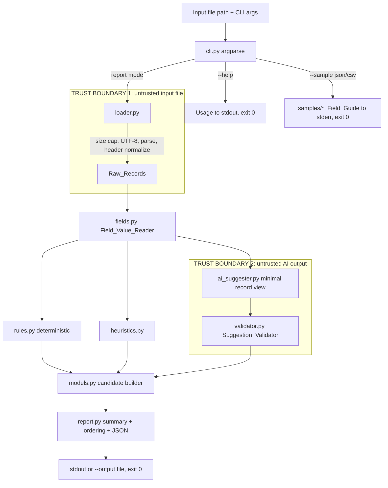

# Design Document

**Feature:** Data Quality Assistant

## 1. Overview and design goals

The Data Quality Assistant (`dq_assistant`) is a small Python command-line tool. It reads a file of item master records (JSON or CSV), runs a fixed set of checks, and writes a JSON **Report** of **review candidates** for a human data steward. It never changes the input data.

Design goals, in priority order:

1. **Human-in-the-loop safety.** The tool only suggests. Every finding is a *candidate* with `status: needs_review` and `allowed_actions: [approve, reject, investigate]`. No apply, merge, or correct step exists. The input file is opened read-only and the in-memory records are never mutated (proven by a property test).
2. **Security / minimal attack surface.** Standard library only, no network, no `eval`/`exec`/`pickle`/`subprocess`, a 5 MiB input cap, UTF-8 only, and errors that never leak field values or stack traces. AI output is treated as untrusted and validated before it reaches the Report.
3. **Simplicity.** One package, small single-purpose modules, no runtime dependencies, no framework. A reviewer can read any module in a few minutes.
4. **Determinism / explainability.** The same input produces byte-identical output. Every finding records why it was detected and which kind of logic produced it (`deterministic_rule`, `heuristic`, `ai_suggestion`).

Runtime depends on **nothing but the Python 3 standard library**. `pytest` and `hypothesis` are development-only and listed in `requirements.txt`.

## 2. Data flow and trust boundaries



Two boundaries are the places where untrusted data enters the system:

- **Boundary 1 — the input file.** Enforced in `loader.py`: extension allow-list, 5 MiB cap checked *before* reading, strict UTF-8, standard `json`/`csv` parsers only, and a fixed error precedence that yields one clean line to stderr and exit code 2.
- **Boundary 2 — the AI output.** Enforced in `validator.py`: every `AI_Suggestion` is checked against a fixed schema (type, confidence range, known category, length limits, required review wording, forbidden terms) before it can become a candidate. This boundary exists now, with a stub behind it, so a real LLM can be dropped in later without weakening any guarantee.

## 3. Package layout

```
agentic-code-test/
├── README.md
├── requirements.txt            # dev-only: pytest, hypothesis
├── pyproject.toml              # package metadata, pytest config (optional, minimal)
├── dq_assistant/
│   ├── __init__.py
│   ├── __main__.py             # python -m dq_assistant → cli.main()
│   ├── cli.py                  # argparse, modes, exit codes
│   ├── loader.py               # JSON/CSV load, size cap, UTF-8, header normalize, errors
│   ├── fields.py               # Field_Value_Reader, Missing_Value, Unbranded_Sentinel, normalizers
│   ├── models.py               # constants, Review_Candidate builder, finding_id
│   ├── rules.py                # deterministic checks (Req 5, 6, 7)
│   ├── heuristics.py           # weak_description, duplicates (Req 8, 9), cross_system_duplicate (Req 22)
│   ├── ai_suggester.py         # AISuggester Protocol + StubAISuggester + minimal record view
│   ├── validator.py            # Suggestion_Validator (Req 11)
│   ├── report.py               # summary, ordering, deterministic JSON, review-language notice
│   └── samples/
│       ├── sample.json         # bundled clean template
│       └── sample.csv          # bundled clean template
├── examples/                   # demo inputs that exercise every Issue_Type (Req 18.8)
│   ├── demo.json
│   └── demo.csv
├── tests/
│   ├── test_cli.py  test_loader.py  test_fields.py  test_rules.py
│   ├── test_heuristics.py  test_validator.py  test_report.py
│   └── test_properties.py      # hypothesis property tests
└── docs/
    ├── spec/                   # copies of requirements.md, design.md, tasks.md
    ├── adr/                    # ADR-0001..0003
    ├── AI_USAGE.md
    └── PROMPTS.md
```

## 4. Module responsibilities and key signatures

**`cli.py`** — parses arguments with `argparse` and dispatches to a mode. Owns exit codes.
```python
def build_parser() -> argparse.ArgumentParser: ...
def main(argv: list[str] | None = None) -> int: ...   # returns 0 / 2 / other
```
Modes: Report (input file), Sample (`--sample`), Help (argparse default). `--help` wins over all other args (argparse handles this). Exit codes: `0` success, `2` usage/input error, `1` output-write/unexpected error.

**`loader.py`** — turns the input file into `list[RawRecord]` or raises `InputError(message, exit_code=2)`.
```python
class InputError(Exception): ...
def load(path: str) -> list[RawRecord]: ...          # applies precedence of Req 3.11
def _normalize_header(name: str) -> str:             # strip BOM, strip(), lower()
```
`RawRecord` is a lightweight dataclass holding `row_index`, the per-field mapping, a `kind` (`json_object` / `json_non_object` / `csv_row`), and a `ragged` flag for CSV rows with too many cells.

**`fields.py`** — the single definition of "missing".
```python
PRESENT, MISSING, INVALID_TYPE = "present", "missing", "invalid_type"
def read(record: RawRecord, field: str) -> tuple[str, str | None]:  # (classification, trimmed value)
def is_unbranded(manufacturer_value: str) -> bool:
def normalize_text(s: str) -> str:
def normalize_mpn(s: str) -> str:
```
Never writes back to the record.

**`models.py`** — constants and the candidate factory.
```python
ISSUE_TYPES, SEVERITIES, SOURCES, UOM_ALLOW_LIST, KNOWN_CATEGORIES
def finding_id(issue_type, row_index, item_id, field) -> str:   # sha256(join '|')[:16]
def make_candidate(...) -> dict:    # fills status, allowed_actions, rounds confidence, truncates observed values
```

**`rules.py`** — `run_rules(records) -> list[dict]`. Malformed/incomplete record, missing part number, unsupported UoM. Pure deterministic, confidence fixed.

**`heuristics.py`** — `run_heuristics(records) -> list[dict]`. Weak description; the duplicate family (`duplicate_item_id`, `conflicting_source_values`, `potential_duplicate`); and `cross_system_duplicate` kept in its own function `_cross_system_duplicates(...)` so Req 22 can be switched off without touching the rest.

**`ai_suggester.py`**
```python
class AISuggester(Protocol):
    def suggest(self, view: dict) -> list[dict]: ...
class StubAISuggester:    # fixed keyword→category map, offline, deterministic
def minimal_view(record, read) -> dict:   # only item_id, item_description, category
```

**`validator.py`** — `validate(suggestion, record) -> dict | None` plus counters. Builds the candidate from validated fields only; sets item_id/row_index/field/severity/source itself.

**`report.py`**
```python
def build_report(records, candidates, ai_enabled, rejected, errors) -> dict:
def to_json(report: dict) -> str:    # ensure_ascii as needed, sort stable, trailing newline
REVIEW_NOTICE = "All findings are candidate issues that need human review by a data steward. No input data was modified."
```

## 5. Report shape (worked example)

```json
{
  "summary": {
    "records_read": 2,
    "candidates_total": 2,
    "by_issue_type": {"missing_part_number": 1, "category_mismatch_candidate": 1, "...": 0},
    "by_severity": {"low": 1, "medium": 1, "high": 0},
    "by_source": {"deterministic_rule": 1, "heuristic": 0, "ai_suggestion": 1},
    "ai_enabled": true,
    "ai_suggestions_rejected": 0,
    "ai_errors": 0,
    "notice": "All findings are candidate issues that need human review by a data steward. No input data was modified."
  },
  "candidates": [
    {
      "finding_id": "a1b2c3d4e5f60718",
      "item_id": "1001", "row_index": 0,
      "issue_type": "missing_part_number", "field": "manufacturer_part_number",
      "severity": "medium", "confidence": 0.95,
      "explanation": "Candidate issue: manufacturer is present but manufacturer part number is missing.",
      "suggested_action": "Confirm the manufacturer part number with the source owner.",
      "source": "deterministic_rule",
      "status": "needs_review", "allowed_actions": ["approve", "reject", "investigate"]
    },
    {
      "finding_id": "0f9e8d7c6b5a4039",
      "item_id": "1002", "row_index": 1,
      "issue_type": "category_mismatch_candidate", "field": "category",
      "severity": "low", "confidence": 0.7,
      "explanation": "Candidate issue: description keyword 'bearing' suggests category Mechanical, recorded as Electrical.",
      "suggested_action": "Review the category assignment before approval.",
      "source": "ai_suggestion",
      "status": "needs_review", "allowed_actions": ["approve", "reject", "investigate"],
      "suggested_category": "Mechanical"
    }
  ]
}
```

Conditional fields: duplicate-family candidates add `related_item_ids` and `related_row_indexes`; `category_mismatch_candidate` adds `suggested_category`.

## 6. Constants and per-check settings

**UoM_Allow_List:** `EA`, `BOX`, `KG`, `G`, `M`, `CM`, `L`, `ML`, `PK`, `ROLL` (case-insensitive match).

**Known_Category_List:** `Mechanical`, `Electrical`, `Plumbing`, `Electronics`, `Safety`.

**Stub keyword → category map** (whole-word, case-insensitive):

| Keyword | Category |
|---|---|
| bearing, gearbox, coupling, valve, pump | Mechanical |
| cable, fuse, breaker, relay, transformer | Electrical |
| pipe, fitting, gasket, flange | Plumbing |
| sensor, resistor, capacitor, pcb | Electronics |
| helmet, glove, goggles | Safety |

**Severity / confidence per check:**

| Issue_Type | Source | Severity | Confidence | Req |
|---|---|---|---|---|
| invalid_record | deterministic_rule | high | 1.0 | 5.1/5.2 |
| missing_required_field (item_id) | deterministic_rule | high | 1.0 | 5.4 |
| missing_required_field (other) | deterministic_rule | medium | 1.0 | 5.4 |
| invalid_field_type | deterministic_rule | medium | 1.0 | 5.6 |
| missing_part_number | deterministic_rule | medium | 0.95 | 6.1 |
| unsupported_unit_of_measure | deterministic_rule | medium | 0.9 | 7.1 |
| weak_description (short) | heuristic | low | 0.8 | 8.1 |
| weak_description (abbrev) | heuristic | low | 0.6 | 8.2 |
| duplicate_item_id | heuristic | high | 0.95 | 9.1 |
| conflicting_source_values | heuristic | medium | 0.85 | 9.2 |
| potential_duplicate (same MPN) | heuristic | medium | 0.9 | 9.8 |
| potential_duplicate (MPN variant) | heuristic | medium | 0.75 | 9.9 |
| cross_system_duplicate | heuristic | low | 0.6 | 22.1 |
| category_mismatch_candidate | ai_suggestion | low | 0.7 | 10.3 |

## 7. Error handling (precedence order, Req 3.11)

| # | Condition | stderr message (one line, no values, no traceback) | Exit |
|---|---|---|---|
| 1 | Path missing / dir / unreadable | "Cannot read input file: <path>" | 2 |
| 2 | Extension not .json/.csv | "Unsupported format; use .json or .csv" | 2 |
| 3 | Size > 5 MiB | "Input exceeds the 5 MiB limit" | 2 |
| 4 | Not valid UTF-8 | "Input must be UTF-8 encoded" | 2 |
| 5 | Empty / whitespace only | "Input file is empty" | 2 |
| 6 | JSON not parseable | "Input is not valid JSON" | 2 |
| 7 | JSON top level not a list | "JSON must be a list of records" | 2 |
| 8 | CSV header unrecognized | "CSV header is missing or unrecognized" | 2 |
| 9 | Zero records | "No records found in input" | 2 |
| — | Output path == input path | "Output path would overwrite the input" | 1 |
| — | Output not writable / exists (sample) | "Cannot write output: <path>" / "Output path already exists: <path>" | 1 |
| — | Unexpected internal error | "Unexpected error while processing input" | 1 |

## 8. Security design

Threats and mitigations:

- **Resource exhaustion (huge file).** 5 MiB cap checked via `os.path.getsize` before reading.
- **Code execution from input.** Only `json`/`csv` parsers; no `eval`/`exec`/`compile`/`pickle`/`marshal`/`subprocess`; no dynamic import of input-derived names.
- **Data exfiltration.** No sockets, no DNS, no outbound anything. Verified by a test that disables socket creation.
- **Information leak via errors.** Error lines name only the path/field/row, never field values, and never a traceback.
- **Encoding tricks / control characters.** Strict UTF-8 decode; the `json` serializer escapes control characters.
- **Untrusted AI output.** Validated at Boundary 2 before output.
- **Spreadsheet formula injection.** Report values are not sanitized for leading `=`/`+`/`-`/`@`; the README warns that any future CSV/Excel export must escape these. (Out of scope now because output is JSON.)

## 9. Adding a real LLM safely

The `AISuggester` Protocol is the single swap point. A real implementation must satisfy the five conditions from Req 17.8 before it is allowed to send data anywhere:

1. **Data minimization** — send only the minimal view (`item_id`, `item_description`, `category`), never the whole record (Req 10.2).
2. **Schema validation** — route every response through the existing `Suggestion_Validator` (Req 11), unchanged.
3. **Timeout** — a bounded request timeout so a slow model cannot hang the run.
4. **No secrets in code** — API keys from the environment, never committed.
5. **Explicit approval** — sending data to an external service is off by default and requires an explicit opt-in flag; the default stays the offline stub.

## 10. docs/PROMPTS.md and the production prompt template

`docs/PROMPTS.md` records, per entry: date, actor (human / agent / sub-agent), purpose, prompt text or summary, output summary, and what was accepted / changed / rejected. It has three parts: (a) prompts already used to build the tool, (b) planned future prompts (design, tasks, implementation, code review, security review) with expected output, and (c) the production LLM prompt template below. No secrets or real customer data.

Production template for the category suggester:

```
System: You classify an inventory item's category from its description. You never modify data.
Return ONLY JSON matching this schema; no prose.
Input (only these fields): {"item_id": str|null, "item_description": str, "category": str}
Output schema:
  {"issue_type": "category_mismatch_candidate",
   "confidence": number 0..1,
   "suggested_category": one of [Mechanical, Electrical, Plumbing, Electronics, Safety],
   "explanation": string (<=500 chars, must contain "candidate"/"potential"/"needs review"),
   "suggested_action": string (<=300 chars, must contain review/verify/confirm/check)}
Return an empty list if the recorded category already fits.
```
Every response is passed through `Suggestion_Validator`; anything failing is dropped and counted.

## 11. Testing strategy

- **Example tests** per module: one per Issue_Type (asserting severity/confidence/source), one per input error (asserting exit 2 + clean stderr), CLI help/sample behavior, UNBRANDED handling, mixed-case headers.
- **Validator tests**: one per acceptance rule plus the specific invalid shapes in Req 19.7.
- **Property tests (hypothesis, ≥100 examples each):**
  - P1 no mutation — records equal their deep copy after all checks (Req 15.5).
  - P2 schema — arbitrary records always yield well-formed candidates (Req 12.1–12.5).
  - P3 determinism — two runs give byte-identical Reports (Req 13.2).
  - P4 MPN — case + separator variants share one Normalized_MPN (Req 9.9).
  - P5 exclusivity — no record gets both `conflicting_source_values` and `cross_system_duplicate` (Req 22.5).
- Run with `python -m pytest`; no network; dev deps only.

## 12. Tradeoffs, alternatives, known limitations

- **Keyword-map stub vs real NLP.** The stub is deterministic and testable; it is intentionally naive. The boundary and validator matter more than the stub's accuracy.
- **One candidate per record vs per group** for duplicates — chosen per-record so each finding maps to one item (Req 9 / assumption 4).
- **JSON keys case-sensitive, CSV headers normalized** — simplest consistent rule; documented.
- **Known limitations:** non-English/whitespace-free languages may be flagged as weak descriptions; duplicate CSV headers collide (last wins); severity/confidence are reasonable defaults, not calibrated; `cross_system_duplicate` (Req 22) may be deferred to README next steps if time runs short.

## 13. ADRs

- **ADR-0001 Deterministic vs heuristic vs AI split** — exact rules carry confidence 1.0; fuzzy checks are heuristics with lower confidence; judgment calls go behind the AI boundary.
- **ADR-0002 AI stub boundary** — Protocol + validator now, stub implementation, real model later under the five conditions.
- **ADR-0003 No mutation** — read-only input, no write-back, proven by property test P1.
